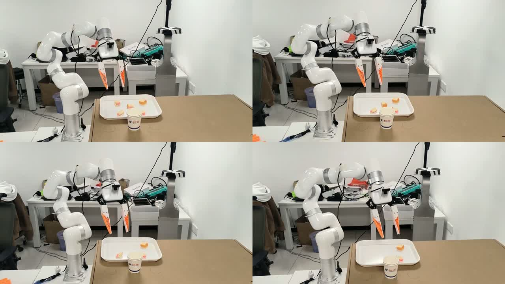
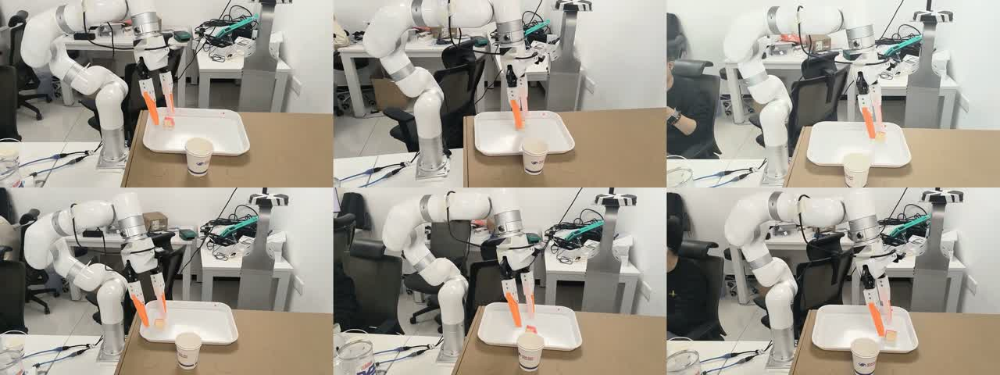
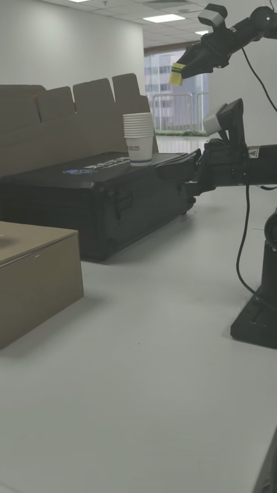
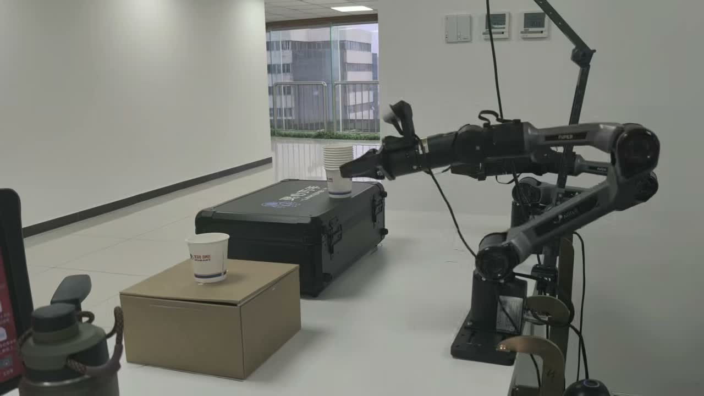

# 何非凡 · Feifan He

**北京工业大学 · 控制科学与工程硕士（预计 2027 年毕业）**  
具身智能 / Vision-Language-Action / Reinforcement Learning / Human-in-the-loop

我关注 VLA 从示范学习到真机后训练的落地：完成 Quest 3 VR—xArm 采训推工程，结合人类接管纠错数据与 STEAM + CFG，探索长程操作和多目标泛化。

**[▶ 进入真机视频展示页](https://ml6362662.github.io/ml6362662/)** · [项目技术说明](PROJECT_NOTES.md)

> 四段真实机器人实验。下面按主要成果优先排列；点击封面进入对应项目并播放视频。

## 01 · 从单目标到多目标：VLA 真机后训练

**任务：** 面向商超试吃场景，完成面包片夹取、放入杯中与杯子递送；重点验证多面包片与场景布局变化下的操作表现。

**我的贡献：** 负责 STEAM + CFG 后训练的真机数据适配、训练设置与部署验证；参与部署 DAgger 式采集及其 GUI，组织人类接管纠错与多目标数据增采。

**实现：** 以综合成功率约 90%、对面包位置适应较好的策略自主 Rollout；在即将失败时人工接管，完成局部纠错后交回策略。将纠错片段与新增多面包示范用于数据迭代，按此前验证的数据要求开展 STEAM + CFG 离线后训练。

**结果：** 多面包片夹取综合成功率 >90%；对托盘移动表现出一定适应能力。

**局限：** 杯子位置变化的泛化仍不足；当前结果来自已测试工况，不能外推为任意场景泛化。

[▶ 在线播放](https://ml6362662.github.io/ml6362662/#xarm-posttraining) · [视频文件](docs/assets/xarm-posttraining.mp4)

## 02 · Quest 3 × xArm：采集、训练与推理全流程

**任务：** 夹取托盘中的单个面包片，放入杯子，再夹取杯子递给顾客；视频以六宫格展示不同面包位置下的操作。

**我的贡献：** 完成 xArm 真机调试、Quest 3 VR 遥操通信联调与全流程设计；编写遥操 GUI 和真机推理 GUI，参与各环节细节设计，完成采训推集成。

**实现：** 接入相机与机器人状态，完成遥操作示教、LeRobot v2.1 数据记录及标注，再进行 π₀.₅ SFT 和真机部署评估。简历记录 xArm 专家示范与 DAgger 式交互数据累计 600+ 条。

**结果：** 当前展示阶段，单面包片任务成功率 >90%。

**局限：** 该阶段仅使用 SFT；多面包片、托盘位置和杯子位置变化的泛化不足，因此进一步开展数据闭环与离线后训练。

[▶ 在线播放](https://ml6362662.github.io/ml6362662/#xarm-sft) · [视频文件](docs/assets/xarm-sft.mp4)

## 03 · 松灵双臂：从物体入杯到杯子堆叠

**任务：** 先夹取小物体并放入杯中，再夹取杯子并堆叠至另一位置，验证多个操作阶段的连续执行。

**我的贡献：** 在前期合作任务基础上参与更复杂的真机实验；同时在服务器复现与验证 STEAM + CFG，梳理训练配置和真机数据要求。

**实现：** 使用 RoboTwin adjust_bottle 任务的 50 条专家轨迹验证后训练流程，厘清数据格式、时序样本与训练设置，并总结真机采集文档，为 xArm 实验迁移积累经验。

**结果：** 完成长程任务视频展示与后训练方法复现验证，形成真机采集要求的经验总结。

**局限：** RoboTwin 验证与松灵视频是并行工作；不将此视频表述为 STEAM + CFG 已在松灵真机上取得量化提升的证据。

[▶ 在线播放](https://ml6362662.github.io/ml6362662/#agilex-long-horizon) · [视频文件](docs/assets/agilex-long-horizon.mp4)

## 04 · 松灵机械臂：从一次杯子放置开始

**任务：** 完成简单杯子放置任务，为后续更复杂、长时序的组合操作建立基础。

**我的贡献：** 与团队共同完成数据采集、格式修改适配、SFT 离线训练与真机推理，在实践中掌握采集要求和部署流程。

**实现：** 参考 RynnValue 的目标条件时间距离建模思路，围绕阶段时序进度探索奖励设计：预测当前观察距离任务目标的剩余时间，并研究将价值变化用作更密集的学习反馈；完成初步测试验证。

**结果：** 积累真实机器人采训推经验，并为复杂任务的奖励建模建立方法基础。

**局限：** 这是基于已有方法的适配探索，不宣称原创 RynnValue，也不以初步测试宣称已解决稀疏奖励信用分配问题。

[▶ 在线播放](https://ml6362662.github.io/ml6362662/#agilex-foundation) · [视频文件](docs/assets/agilex-foundation.mp4)

## 实验结果与统计范围

| 实验阶段 | 设置 | 结果 |
| --- | --- | --- |
| 早期完整任务（简历记录） | SFT → STEAM + CFG 后训练 | 73% → 94% |
| 当前单面包片阶段 | SFT | 任务成功率 >90% |
| 当前多面包片阶段 | 纠错数据 + 多目标数据 + STEAM / CFG | 综合成功率 >90% |

以上结果属于不同实验阶段，不作跨阶段的直接增益比较。试验次数、布局分布等完整评估记录尚未随主页公开，视频仅作定性演示。

## 后续计划

- [ ] 补充不同杯子位置和相对布局的数据，提升杯子位置泛化。
- [ ] 建立分阶段失败标签，定位夹取、入杯、杯子抓取及递送瓶颈。
- [ ] 固定评估协议，补充试验次数、分项成功率与泛化测试集。
- [ ] 对数据增采、DAgger 纠错与 STEAM + CFG 分别开展消融。
- [ ] 持续探索任务进度奖励与在线强化学习。

## 关于我

- 北京工业大学，控制科学与工程硕士，2023–2027（预计）；三峡大学，自动化本科，2019–2023。
- 灵美智能实习：双臂机器人训练链路与奖励建模、xArm VLA 后训练与真机验证。
- 其他研究：人机共驾强化学习、示范质量评估与 CARLA 人在回路实验平台。
- 中国机器人及人工智能大赛：2025 年国家级一等奖、2026 年国家级三等奖（学生第一）。
- 工具与框架：Python、PyTorch、Linux、LeRobot、RLinf。

## 方法来源

感谢 [RynnValue](https://github.com/alibaba-damo-academy/RynnValue) 与 [RLinf STEAM + CFG](https://rlinf.readthedocs.io/en/latest/rst_source/examples/embodied/steam.html) 的开放工作。本文明确区分原始算法贡献与我的工程适配、数据流程、复现和真机实验贡献。

本仓库用于实验展示；未包含团队内部训练代码、模型权重或原始采集数据。
